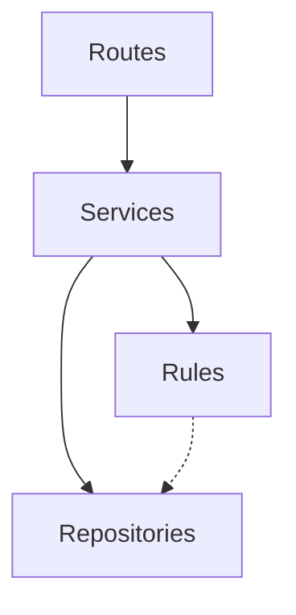
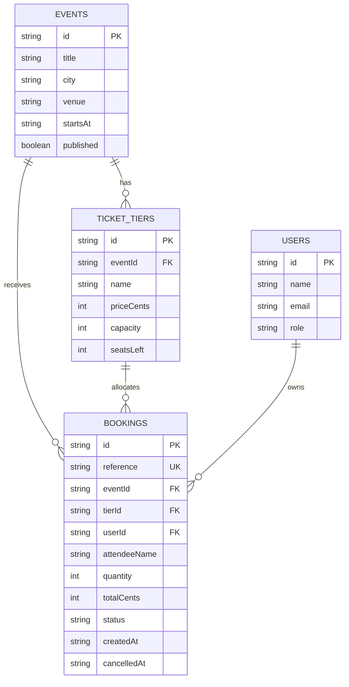
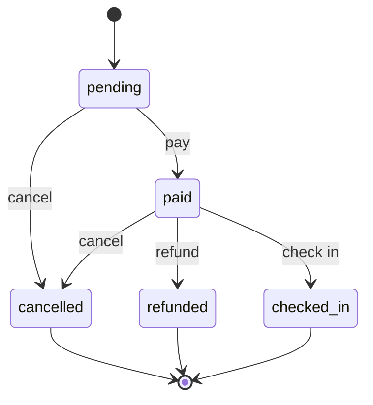

# System Architecture

## Layered Architecture

- **Routes:** A route may parse incoming HTTP requests and format JSON responses or status codes, and may not contain business rules, state transition logic, or direct repository mutations.
- **Services:** A service may coordinate use cases across rules and repositories, and may not handle raw HTTP transport details or bypass domain rules.
- **Rules:** A rule may enforce domain invariants, validate inputs, and evaluate state transitions, and may not depend on HTTP layers or call upward into services or routes.
- **Repositories:** A repository may store, retrieve, and query domain records and queues, and may not enforce business policy or call services or routes.

## Data Model

## Booking Life Cycle

